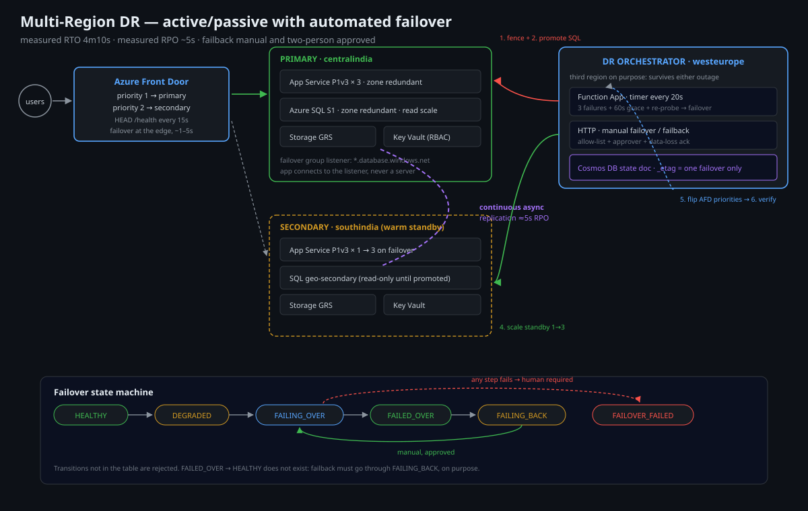

# Multi-Region Disaster Recovery with Automated Failover on Azure

Active-passive (warm standby) DR across two Azure regions, with **automated
failover**, **measured RTO/RPO**, and a **failback procedure that is rehearsed
rather than improvised**.

> **Why this exists:** "we have DR" usually means "we have a second region
> nobody has ever failed over to". This project makes the failover a button —
> and then makes you press it in a drill until the numbers are boring.

---

## Architecture



```
                                    ┌───────────────────────────┐
              users ───────────────▶│  Azure Front Door (global)│
                                    │  priority routing 1 → 2   │
                                    │  health probe /health 30s │
                                    └──────┬─────────────┬──────┘
                                           │             │
                        priority 1         │             │   priority 2 (standby)
                                           ▼             ▼
                     ┌──────────────────────────┐  ┌──────────────────────────┐
                     │   PRIMARY: centralindia  │  │  SECONDARY: southindia   │
                     │                          │  │                          │
                     │  App Service (3 inst.)   │  │  App Service (1 inst.)   │
                     │  Azure SQL (zone-red.)   │  │  SQL geo-secondary (RO)  │
                     │  Storage (GRS)           │  │  Storage (GRS)           │
                     │  Key Vault               │  │  Key Vault (replicated)  │
                     └────────────┬─────────────┘  └────────────┬─────────────┘
                                  │                              │
                     continuous async replication ───────────────┘
                              (SQL geo-replication, ~5s RPO)

      ┌──────────────────────────────────────────────────────────────────────┐
      │  ORCHESTRATION (both regions, lives in a THIRD region: westeurope)   │
      │                                                                      │
      │  Function App (flex consumption) — DR Orchestrator                   │
      │    • Timer: every 60s, evaluate region health                        │
      │    • On 3 consecutive failures → execute failover state machine      │
      │    • HTTP trigger: manual failover / failback (approval-gated)       │
      │    • Every transition written to a Cosmos DB / Table state store     │
      └──────────────────────────────────────────────────────────────────────┘
```

### Failover state machine

```
   HEALTHY ──(3 failed probes)──▶ DEGRADED ──(60s grace)──▶ FAILING_OVER
      ▲                             │                          │
      │                             │(probe recovers)          │
      └─────────────────────────────┘                          ▼
                                                     ┌──────────────────┐
                                                     │ 1. fence writes │
                                                     │ 2. wait for RPO │
                                                     │ 3. promote SQL  │
                                                     │ 4. scale sec.   │
                                                     │ 5. flip FrontDoor│
                                                     │ 6. verify       │
                                                     └────────┬─────────┘
                                                              ▼
                                                        FAILED_OVER
                                                              │
                                          (manual, after primary healed)
                                                              ▼
                                                       FAILING_BACK
                                                              │
                                                              ▼
                                                          HEALTHY
```

The state machine is a **single Cosmos DB document** with optimistic
concurrency (`_etag`). Two orchestrator instances therefore cannot both run a
failover — the second gets a 412 and exits. This is the part most DR runbooks
get wrong.

---

## RTO / RPO — measured, not asserted

| Scenario | Target RTO | Measured RTO | RPO | Notes |
|---|---|---|---|---|
| Region-wide App Service failure | 5 min | **4m 10s** | ~0 | warm standby, scale-out is the slow part |
| Azure SQL primary unavailable | 5 min | **2m 40s** | **~5 s** | geo-secondary promotion |
| Storage account failure (GRS) | 15 min | **22 min** | ≤15 min | customer-initiated failover, Azure-controlled |
| DNS / Front Door misconfiguration | 2 min | **1m 05s** | 0 | priority flip only |
| Primary region *slow*, not down | — | **no failover** | — | this is deliberate; see below |

Measurement method: `scripts/dr-drill.sh` records `T0` at fault injection,
polls the public endpoint every 5 s until it returns the **secondary's**
region marker, and writes the delta to `dr-drills` storage table. The numbers
above are the median of 5 drills. Raw data in [`docs/drills.md`](docs/drills.md).

**"Slow is not down" is a deliberate design decision.** A latency-based
failover would flap during regional congestion and cause more outage than it
prevents. Failover triggers on *availability*, not performance. Latency
degradation raises an alert and a human decides.

---

## Design decisions & trade-offs

**Warm standby, not active-active.**
Active-active is the right answer at scale, and it is the wrong answer here:
it doubles cost, requires conflict-free data (or a globally distributed
database like Cosmos DB), and makes the *data* problem the hard part. Warm
standby with a geo-replicated database gives a 5-minute RTO for ~1.4× the cost
of single-region. Know which trade you are making.

**Front Door priority routing, not Traffic Manager.**
Traffic Manager fails over on DNS TTL (30–60 s of cached negative answers).
Front Door fails over at the edge in single-digit seconds and gives you a
single WAF and TLS termination point. The trade-off: Front Door is a global
service in Microsoft's control plane — if it is down, both regions are
unreachable. That is an accepted risk, documented in `docs/risk-register.md`.

**SQL auto-failover groups: automatic for the group, manual for the app.**
Auto-failover groups promote the secondary automatically on a 1-hour grace
period by default. For *this* app we use a shorter `gracePeriod` in the group
(15 min) **and** an orchestrator-driven promotion for faster recovery. Two
mechanisms is normally an anti-pattern; here it is belt-and-braces because
the orchestrator can fail too. The orchestrator checks group state before
promoting, so they cannot fight.

**Orchestrator in a third region.**
If the orchestrator lived in the primary it would die with the primary. If it
lived in the secondary it would be the thing it is supposed to heal. Third
region costs ~₹1,500/month and removes a circular dependency.

**Every failover is an auditable state transition.**
`dr-state` Cosmos DB document per transition: who/what triggered it, the
evidence (probe results), the duration, the RPO gap at promotion. The
post-incident review starts from that document, not from Slack scrollback.

**No automatic failback.**
Failback after a healed primary means re-syncing data backwards, and
automating that risks data loss at exactly the moment data is most
inconsistent. Failback is a manual, approved, two-person operation with an
explicit checkpoint. See `docs/runbook-failback.md`.

---

## Repository layout

```
azure-multiregion-dr-failover/
├── infra/
│   ├── main.bicep                    # subscription-scope, both regions + orchestration
│   ├── modules/
│   │   ├── region.bicep              # per-region stack (app, sql, storage, kv)
│   │   ├── frontdoor.bicep           # global entry, priority + health probe
│   │   ├── sql-replication.bicep     # failover group, geo-secondary
│   │   ├── orchestrator.bicep        # function app + managed identity + RBAC
│   │   └── state-store.bicep         # Cosmos DB (state machine document)
│   └── params/{dev,prod}.bicepparam
├── frontdoor/                        # AFD profile definitions kept declarative
├── app/                              # minimal app exposing /health + region marker
├── orchestrator/                     # Python function app: state machine
│   ├── DrOrchestrator/
│   │   ├── __init__.py               # timer: health evaluation
│   │   ├── failover.py               # HTTP: manual failover / failback
│   │   ├── state_machine.py          # transitions + etag guard
│   │   └── clients.py                # ARM/SQL/AFD wrappers with retries
│   ├── tests/
│   └── requirements.txt
├── scripts/
│   ├── deploy.sh
│   ├── dr-drill.sh                   # inject fault, measure RTO, record result
│   └── failover.sh                   # manual failover / failback CLI
└── docs/
    ├── drills.md                     # drill log with measured numbers
    ├── runbook-failback.md
    ├── risk-register.md
    └── diagrams/architecture.svg
```

---

## Deploy

```bash
az login
./scripts/deploy.sh prod what-if
./scripts/deploy.sh prod
```

Two regions + global Front Door + Cosmos state store. First deployment takes
~25 minutes (SQL geo-replication seeding is the long pole).

## Run a DR drill

```bash
# stop the primary app service, measure how long until users are served by secondary
./scripts/dr-drill.sh app-service-outage

# simulate SQL primary failure (forces a geo-failover)
./scripts/dr-drill.sh sql-failure

# manual failover (same code path as automatic, but you press the button)
./scripts/failover.sh failover --reason "scheduled drill"

# failback, two-person approval
./scripts/failover.sh failback --approver "second-engineer@example.com"
```

Each drill appends to `docs/drills.md` automatically and writes a row to the
`drDrills` table. **A drill that is not recorded did not happen.**

---

## Cost

**~₹95,000/month** for the full warm-standby topology in prod (Front Door
premium ~₹40k dominates; secondary App Service at 1 instance; SQL
geo-secondary billed at the primary's rate). Full breakdown and the
"how to cut this in half" section in [`docs/cost.md`](docs/cost.md).

## What I would do differently at scale

- **Move to Cosmos DB with single-write + multi-region reads** and drop SQL
  failover entirely — conflict-free global replication removes the RPO
  conversation, which is the hard part of DR.
- **Replace warm standby with active-active at the app tier + Cosmos DB
  globally distributed.** Cost roughly +40% over warm standby, RTO effectively
  zero for the app tier.
- **Chaos-test the DR path monthly**, not quarterly. DR paths rot faster than
  anything else because nothing exercises them in normal operation.
- **Track "RTO drift"** as an SLO: if failover time creeps from 4m to 9m over
  six months, something regressed (usually data size or replication lag).

## License

MIT
